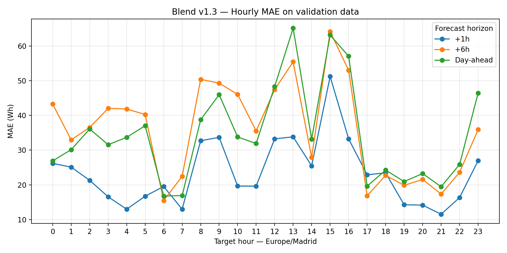
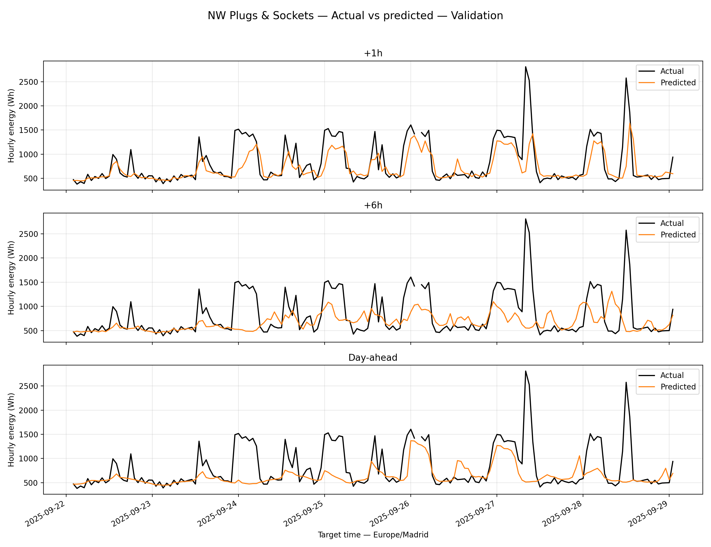
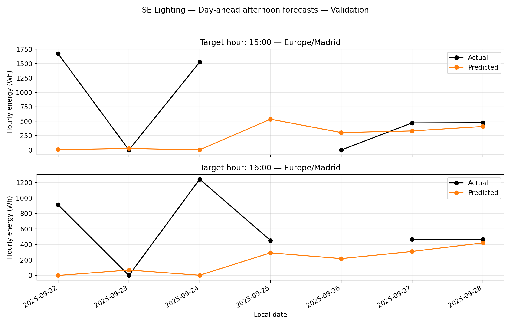

# Sprint 4 - Task 1: Temporal error analysis of Blend v1.3

**Contributor:** Maria Francesca Casillo  
**Scope:** Person 2 - Temporal analysis  
**Date:** 5 November 2026  
**Status:** Validation diagnosis completed; joint interpretation with performance and data-quality workstreams pending.

## 1. Purpose and main findings

This contribution investigates **when and how the frozen Blend v1.3 makes errors**. It supports prioritisation of Sprint 4 investigations; it does not retrain the model, change its weights, select a replacement model or establish the physical causes of consumption changes.

Two distinct patterns emerge: recurring night-time underprediction on **NW|Plugs & Sockets**, and large afternoon misses on **SE|Lighting** concentrated on 22 and 24 September. NW Plugs errors are also higher during the observed weekend, but calendar effects cannot be separated from specific consumption episodes using one week.

## 2. Data and method

Input: `ML_Blend_v1.3_validation_predictions.csv`, exported by Sprint 3 Task 6. The file has 8,064 rows: 16 circuits x 168 target hours x 3 forecast horizons. There are 7,239 usable actual/prediction pairs, or 2,413 per horizon. The 825 rows without actual consumption are excluded from error calculations, never replaced with zero. These counts repeat targets across horizons; they do not represent independent hours.

Validation target period: **22 September 2025 00:00 UTC to 29 September 2025 00:00 UTC, end exclusive**. In Madrid this runs from 22 September 02:00 to 29 September 02:00, end exclusive. Local calendar groupings therefore include partial boundary dates.

The CSV field `zone` identifies the full circuit, while `circuit_zone` identifies NE/NW/SE/SW. `horizon_h=24` labels the day-ahead product, not a constant 24-hour lead for every prediction.

- Error = predicted minus actual energy: positive means overprediction; negative means underprediction.
- MAE = mean absolute error, in Wh per hourly observation.
- Mean signed error describes direction; positive and negative errors can cancel.
- All analyses separate +1h, +6h and day-ahead.
- Target timestamps are converted to `Europe/Madrid` before extracting hour and weekday.
- **Night** is an explicit analysis band, 00:00-05:59; **Other hours** is 06:00-23:59. This is not an asserted building operating schedule.
- Weekend means Saturday/Sunday according to the local target date.

Overall summaries pool available circuit-hour observations. They are influenced by circuit consumption scale and by which observations are available. They use the Blend's available pairs, **not the common mask used to compare all models in Task 6**.

## 3. Hourly overview



The largest pooled hourly MAE occurs at 15:00 for +1h (51.20 Wh) and +6h (64.13 Wh), and at 13:00 for day-ahead (65.11 Wh). These averages do not establish that every circuit or every date has the same difficulty.

For day-ahead, NW Plugs contributes 65.7% of total absolute error at 13:00. SE Lighting contributes 61.4% at 15:00 and 45.3% at 16:00. These are contributions to the error sum at those hours, not percentage prediction errors.

Evidence: `outputs/errors_by_local_hour.csv` and `outputs/errors_by_circuit_and_hour.csv`. The contribution shares can be reproduced from `total_absolute_error_Wh` and are also printed by the script.

## 4. NW Plugs & Sockets



The +1h forecast follows several changes more closely, but attenuates some peaks. At +6h and day-ahead, several elevated-consumption periods are underpredicted and some increases are forecast when actual consumption is lower. This is a visual diagnosis, supplemented by the tables below.

### Night versus other hours

| Horizon | Night MAE (Wh) | Other-hours MAE (Wh) | Night / other | Night mean signed error (Wh) |
|---|---:|---:|---:|---:|
| +1h | 245.63 | 179.31 | 1.37 | -224.63 |
| +6h | 460.60 | 234.76 | 1.96 | -410.30 |
| Day-ahead | 406.42 | 206.71 | 1.97 | -384.62 |

Each horizon has 41 valid night observations and 126 other-hour observations. Higher night MAE is circuit-specific: pooled across all circuits, night MAE is higher only at +6h.

### Recurrence across nights

Of the five complete six-hour windows, the mean signed error is negative in four at +1h, four at +6h and all five day-ahead. Magnitude matters: day-ahead mean error is only -11.29 Wh on 23 September, but -909.27 Wh on 24 September and -801.50 Wh on 25 September.

Recorded mean night consumption rises from 467.84 Wh on 23 September to approximately 1,250-1,470 Wh in the observed windows on 24-28 September. All three horizons underestimate the mean in those later windows. This describes a change within validation; this analysis does not itself verify the training-period behaviour or the cause.

22 and 29 September have partial windows because of UTC split boundaries; 26 September has five valid hours. Their results are retained and explicitly flagged rather than counted as complete nights.

### Weekday versus weekend

| Horizon | Weekday MAE (Wh) | Weekend MAE (Wh) |
|---|---:|---:|
| +1h | 171.31 | 255.80 |
| +6h | 227.98 | 444.48 |
| Day-ahead | 213.89 | 359.51 |

Each horizon has 119 weekday and 48 weekend observations for NW Plugs. Underprediction predominates in both groups. One weekend and its large consumption episodes are insufficient to infer a general weekend effect. The six weekday dates include the partial Monday 29 September; they are not six complete days.

Evidence: `nw_plugs_nightly_summary_validation.csv`, `night_vs_other_hours_validation.csv`, and `weekday_vs_weekend_validation.csv` in `outputs/`.

## 5. SE Lighting: concentrated afternoon misses



Each panel compares the same local target hour across dates; connecting lines do not represent continuous consumption between dates. Missing actual values appear as gaps.

| Local target time | Actual (Wh) | Day-ahead predicted (Wh) | Signed error (Wh) |
|---|---:|---:|---:|
| 22 September 15:00 | 1,671.76 | 6.86 | -1,664.90 |
| 22 September 16:00 | 911.30 | 0.12 | -911.18 |
| 24 September 15:00 | 1,526.63 | 2.69 | -1,523.94 |
| 24 September 16:00 | 1,241.81 | 2.71 | -1,239.10 |

These four observations account for approximately **84.7% of the day-ahead absolute error for SE Lighting at 15:00 and 16:00 over the validation week**. This denominator is restricted to these two hourly slots and this circuit, not all project errors.

The same four targets have large underpredictions at +6h. At +1h the response differs: 22 September 16:00 is overpredicted by 429.66 Wh. The 25 September 15:00 and 26 September 16:00 actuals are missing and cannot be scored. On 26 September 15:00, the day-ahead model overpredicts approximately 302 Wh against a recorded zero.

Thus, high average afternoon errors are largely episode-driven rather than equally severe every day. Recorded zeros and abrupt level changes require data-quality and operational checks before being interpreted as physical events.

Evidence: `outputs/se_lighting_afternoon_details_validation.csv`.

## 6. Findings and handover

| Finding | Evidence | Next investigation / owner |
|---|---|---|
| Recurring NW night underprediction | Night MAE nearly twice other-hour MAE at +6h/day-ahead; repeated misses on 24-28 September | Person 3: check data and training representation; building/data owner: verify operating changes |
| NW weekend errors elevated | Higher MAE at all horizons in the observed weekend | Persons 1 and 2: relate to specific episodes; do not label a general weekend effect |
| SE afternoon average driven by few targets | Four observations explain 84.7% of restricted day-ahead error | Person 3: inspect flags, provenance and source readings at the four timestamps before proposing model changes |
| Aggregate results hide different behaviours | NW dominates 13:00, SE Lighting dominates 15:00-16:00 | Person 1: combine with circuit-level metrics and observation counts |

Priority should be agreed jointly after data-quality checks. These findings justify targeted investigations, not an automatic change to the model.

## 7. Limits and evaluation boundary

This is an exploratory **validation diagnosis** of a model already selected on that validation set, not independent evidence of generalisation. No test forecasts were used by this script, and no weights, parameters or training data were changed. The selected hours and circuits were identified during exploration and are not pre-registered hypotheses.

There is one week, one weekend and uneven observation availability. No significance test or causal claim is made. Missing targets may affect the composition of comparisons. A small signed mean can hide large errors of opposite directions. Day-ahead predictions share a daily issue schedule, so target clock hour and lead are linked; these plots cannot isolate the effect of forecast distance. This work does not estimate prediction intervals or establish waste/anomaly labels.

## 8. Reproduction and deliverables

Keep `temporal_analysis.py` and the input CSV in the same folder. In a terminal in that folder:

```bash
python -m pip install pandas matplotlib tzdata
python temporal_analysis.py
```

The script reads saved forecasts, creates/updates its own `outputs/` directory and does not run model training or tuning. Re-running overwrites generated files with the same names.

Included: original script, input CSV, six output CSVs and three PNG figures. The script was executed during review; all six generated tables matched the supplied outputs within numerical tolerance, and no duplicate circuit/horizon/target-hour keys were found in the input. This verifies reproduction of this analysis, not the full forecasting pipeline.
