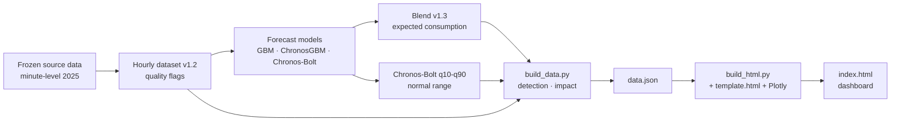

# Technical Documentation — Energy Waste & Anomaly Detection (CeDInt Storey 1)

**Project:** TBDA Group 2 · CeDInt-SEF · **Product:** decision-support tool for the CeDInt building at UPM
**Version:** 12 Nov 2026 · **Backlog items covered:** PB-54 (documentation), PB-14/15/16/17/18 (data), PB-23–PB-30 (forecast), PB-33–PB-39 (detection), PB-40–PB-53 (dashboard)

This document explains how the product is set up, which data it uses, how expected consumption is forecast, how alerts are produced and how the dashboard works. Every statement is tied to a file of the repository (`TBDA-Classes/2026G2`) or to a script of this package. Where the repository does not document something, the text says **"not documented"** instead of guessing.

---

## 1. Product scope and boundaries (PB-01 to PB-05)

| Item | Statement |
|---|---|
| Purpose | Analyse historical electricity use of Storey 1, forecast normal consumption, compare it with actual use, flag potentially unnecessary or abnormal periods and communicate energy, cost and CO₂ impact. |
| Users | Building Manager, Energy/Sustainability Officer, Maintenance Technician, Sponsor/Technical Owner. |
| Nature | Historical-data decision support. It **does not control** lighting, HVAC or any equipment. |
| Excluded | Real-time streaming, changes to the live building pipeline, hardware integration. |
| Spatial scope | Storey 1, zones NE, NW, SE, SW; 16 circuits with 2025 data. |
| Time scope | Forecast and detection window of the product: 22 Sep – 5 Oct 2025 (validation week + test week). Hourly data exist up to 13 Oct 2025. |

## 2. Architecture

Python produces every number. The dashboard (`index.html`) only displays them and recomputes impact (€, CO₂) and alert lists when the user changes filters or assumptions. No model runs when the dashboard is opened.

## 3. Setup

| Need | Detail |
|---|---|
| Open the dashboard | Double-click `index.html`. Any modern browser, works offline. |
| Rebuild the dashboard | Python 3.10+, `pip install -r requirements.txt` (pandas, numpy, pyarrow, plotly). |
| Rebuild the model forecasts | Not part of this package: see `TBDA_v1.3_ChronosGBM_29-10/README_v1.3.md`. Needs `scikit-learn`, `torch`, `chronos-forecasting` and the Chronos-Bolt weights from Hugging Face (not in Git). |
| Pipeline (this package) | `python source/run_all.py` runs seven steps: presence series, occupancy evidence, standby and W/I analysis, accuracy metrics, `build_data.py`, `injection_test.py`, `build_html.py` (about 13 s). |

Inputs read by `build_data.py` (read-only): the Task 6 forecasts `Task6_rev0_03-11/results/predictions/ML_Blend_v1.3_{validation,test}_predictions.csv`, the Chronos-Bolt forecasts `TBDA_v1.3_ChronosGBM_29-10/results/chronos_{validation,test}_predictions_v1.3.parquet`, and the hourly dataset `TBDA_v1.3_ChronosGBM_29-10/derived/Storey1_hourly_v1.2.parquet`.

## 4. Data (PB-13 to PB-18)

### 4.1 Source and derived data
- **Frozen source dataset:** minute-level 2025 readings per device (energy `energy_Wh`, power `W`, current `I`, cumulative counters `Ea`/`Er`, environmental sensors). It is never modified; each run checks the checksum (`PROTOCOL_NOTE_v1.2.md`, `Task7&8 summary`).
- **Data dictionary:** `Storey1_data_dictionary_missing_anomalies_EN.xlsx` (sheets *Data Dictionary*, *Missing Data*, *Anomalies*). `W` and `I` are listed with units **assumed** (W, A), which is why they are not forecast (see `02_Assumptions_and_Decisions.md`, section 5).
- **Hourly dataset v1.2:** one row per circuit and hour, 16 circuits × 1,341 hours = 21,456 rows (18 Aug 18:00 UTC – 13 Oct 14:00 UTC), with columns including `energy_Wh`, `energy_valid`, `energy_catch_up`, `energy_pre_outage`, `energy_inconsistent`, `W_mean`, `I_mean`, `split`, `is_holiday`.

### 4.2 Hourly construction rules (decisions D1–D5, `DECISIONS_v1.2.md`)
| Rule | Value | Meaning |
|---|---|---|
| D1 hour validity | at least one reading; max gap 15 min; tail max 5 min | Energy after a gap covers the gap, so sparse hours can still be complete. The 15-min cap limits energy moving across an hour boundary. |
| D2 inconsistent hour | invalid if `energy_Wh > 2 × W_mean + 1 Wh` (checked only with ≥ 30 min of power) | Energy higher than the measured power can deliver. |
| D3 zero energy with power | counted, not flagged | Hand dryers make a two-sided rule unreliable. |
| D4 training circuits | ≥ 168 valid training hours and ≤ 50 % flagged | 15 of 16 circuits train; SE Plugs & Sockets is forecast as "cold start". |
| D5 reporting | all 16 circuits and a "core-8" (NE/NW) table | Teacher required all circuits; core-8 keeps continuity. |

Missing hours are never treated as zero (specification §5). The dashboard shows them separately as **data issues** with their reason (no readings, catch-up after a gap, interrupted before an outage, energy above what power allows).

### 4.3 Time basis (PB-16)
Timestamps are stored in UTC and displayed in **Europe/Madrid** (daylight saving handled by the library). No daylight-saving change occurs in the 22 Sep – 5 Oct window. Holiday calendar: ES/MD (`config.py`); no holiday falls in the window, and Madrid city holidays or UPM closing days are **not documented** in the repository.

### 4.4 Data readiness summary (PB-18)
Within the dashboard window, 88 % of circuit-hours have a valid reading. SW and SE circuits and NW emergency lighting have most of the gaps. SE Plugs & Sockets has 86 % of its training hours flagged by rule D2 (`DECISIONS_v1.2.md`, D4). NE has no environmental-sensor coverage for several variables (Modelling Specification §8).

### 4.5 Load types (PB-06 to PB-12)
Circuits per zone and load type as found in the data: NW (emergency lighting, HVAC, hand dryer, lighting, plugs & sockets, rack); NE (HVAC, plugs & sockets); SW (emergency lighting, hand dryer, lighting, plugs & sockets); SE (emergency lighting, HVAC, lighting, plugs & sockets). Emergency lighting is kept separate from lighting. No unavailable load is inferred (for example SW has no HVAC circuit). **The final circuit-to-load mapping still needs formal validation by the data owner** (PB-06/PB-12).

## 5. Forecasting model (PB-23 to PB-32)

### 5.1 Target and protocol (frozen)
- Target: `energy_Wh`, hourly, per circuit. Horizons: **+1 h**, **+6 h**, **day-ahead** (issued 00:00 Europe/Madrid, leads 1–24 h).
- Chronological split (UTC): train 19 Aug – 21 Sep 2025, validation 22–28 Sep, test 29 Sep – 5 Oct. Fit on training only, configuration chosen on validation and frozen, test used once (`README_parameters.md`, §1).
- No feature may use information after the issue time (asserted in `task8_model.py` and `chronos_model.py`).
- Metrics: MAE (primary), RMSE (secondary); selection metric = mean scaled MAE over the 15 training circuits (MAE ÷ circuit training mean).

### 5.2 Models compared (Task 6, `Task6_rev0_03-11/README.md`)
Baselines **B1** (same hour last week), **B2** (weekday × hour median), **B3** (persistence); machine learning: Linear Regression, Random Forest, GBM (v1.0, v1.3), Chronos-Bolt (zero-shot, v1.1 and v1.3), ChronosGBM v1.3 (GBM with Chronos forecasts as inputs), **Blend v1.3**.

### 5.3 Final model: Blend v1.3
Weighted average of three frozen forecasts, weights chosen per horizon on validation by rule D10 (`models/blend_frozen_config_v1.3.json`):

| Horizon | w GBM | w ChronosGBM | w Chronos-Bolt | Chronos-Bolt setting |
|---|---|---|---|---|
| +1 h | 0.30 | 0.20 | 0.50 | base, context 588 h, mean of quantiles |
| +6 h | 0.10 | 0.35 | 0.55 | tiny, context 24 h, median |
| day-ahead | 0.15 | 0.10 | 0.75 | base, context 72 h, median |

Selection rule D10 (agreed 29 Oct 2026): candidates within 0.005 scaled MAE of the best are tied; the tie is broken by lowest scaled RMSE, then by the simpler model. Baselines are tracked in every tuning row but cannot be chosen. Grid sizes v1.3: GBM and ChronosGBM 128 combinations each, Chronos-Bolt 104, Blend 231 (`README_v1.3.md`). See `03_Experiment_Log.md`.

### 5.4 Accuracy on the unseen test week (29 Sep – 5 Oct 2025, 16 circuits, 1,911 hours per horizon)
From `Task6_rev0_03-11/RESULTS.md`:

| Model | MAE +1 h | MAE +6 h | MAE day-ahead |
|---|---|---|---|
| **Blend v1.3** | 22.2 Wh | 34.7 Wh | 34.2 Wh |
| Chronos-Bolt v1.3 | 21.5 | 36.9 | 36.2 |
| Baseline C (persistence) | 24.0 | 57.8 | 41.5 |
| Baseline B (weekday × hour) | 43.7 | 43.7 | 43.7 |
| Baseline A (last week) | 59.1 | 59.1 | 59.1 |

Blend v1.3 is better than Baseline B at every horizon (significant by 95 % block-bootstrap CI). Against persistence it is significantly better only at +6 h; at +1 h and day-ahead the difference is a tie. On SE/SW circuits, which barely train, persistence has the lowest MAE at +6 h and day-ahead.

**Additional metrics (PB-29)** computed for the dashboard in `analysis/accuracy_metrics_MAPE_CVRMSE.csv` (own recomputation on the hours available in the dashboard window, circuit-hour pooled): Blend MAE 20.1 / 31.1 / 30.7 Wh, WAPE 16 / 25 / 25 %, CV(RMSE) 71 / 103 / 105 %, MAPE 12 / 17 / 17 % (hours ≥ 10 Wh only, because MAPE explodes near zero). The specification advises against relying on MAPE where values approach zero. These numbers use a different hour mask from Task 6, so they differ slightly from the official MAE; **the official figures are those of Task 6**.

### 5.5 Prediction interval (PB-30)
The normal range is the Chronos-Bolt v1.3 10–90 % band at the day-ahead horizon, clipped so that the Blend forecast always lies inside. Observed coverage: **82 %** on test and validation (nominal 80 %); per horizon and per circuit in `analysis/band_coverage_*.csv`. The coverage of some circuits is lower (hand dryers, SW plugs).

### 5.6 Weather
Outdoor temperature was tested in Sprint 4 Task 2 (Open-Meteo; GBM and ChronosGBM parts only). It made the Blend worse at +1 h (+0.0068 scaled MAE) and +6 h (+0.0080) and gave no clear change day-ahead (−0.0003). **Decision: temperature is not added** (`Sprint4_Task2_Temperature/REPORT.md`).

### 5.7 Known weaknesses (Sprint 4 Task 1)
NW Plugs & Sockets (night under-prediction) and SE Lighting (afternoon misses on 22 and 24 Sep) together carry 75.9 % of the pooled day-ahead absolute error on validation (`Sprint4_Task1_Diagnosis/CONCLUSIONS.md`). Operational causes are unconfirmed.

## 6. Anomaly and waste detection (PB-33 to PB-39)

| Element | Rule |
|---|---|
| Expected value | Blend v1.3 day-ahead forecast. |
| Normal range | Chronos-Bolt q10–q90 band. |
| Alert hour | Actual > upper limit **and** excess (actual − expected) ≥ max(floor Wh, share × circuit mean load). |
| Sensitivities | Strict (20 %, 40 Wh), Balanced (10 %, 20 Wh), Sensitive (5 %, 10 Wh). Balanced is the default. |
| Alert | Consecutive alert hours of one circuit form one alert. |
| Data issues | Hours flagged by the quality rules never raise an alert and are listed separately (PB-35). |
| Severity | **High** if excess ≥ 1 kWh, or ≥ 6 consecutive hours, or ≥ 50 % of the alert is out of occupied hours with excess ≥ 0.5 kWh. Otherwise **Warning**. Thresholds are an engineering choice, documented and adjustable in `build_data.py` (PB-36). |
| Occupied hours | Non-holiday weekdays 07:00–20:00 Europe/Madrid. Derived from the presence detector `Pres` (called "Bsens" in the team): NW and SE show a clean curve; the rule covers 85–91 % of hours with detected presence; NE has no detector; the SW detector is stuck near 1 and is unusable. |
| Impact | excess kWh × price (€) and × CO₂ factor. Estimates only (see `02_Assumptions_and_Decisions.md`). |

Results in the 14-day window: 66 / 73 / 78 alerts (Strict / Balanced / Sensitive), i.e. 4.7 / 5.2 / 5.6 per day. The known events of the test week (NE HVAC left on, 3 Oct) are detected at every sensitivity. The NW emergency-lighting records of 4–5 Oct are labelled "impossible" (energy above what the power allows) in `task6_events_test.csv` and are shown as data issues, not as waste. Detection quality on artificial anomalies: `04_Detection_Validation.md`.

## 7. Context analyses (PB-19 to PB-21)
- **Out-of-hours use (PB-19):** about 60 % of the measured energy is used outside occupied hours (`analysis/standby_baseline_by_circuit.csv`).
- **Standby baseline (PB-20):** per circuit, the median hourly use outside occupied hours. For NW Plugs & Sockets it is about 535 Wh per hour, with a night/day ratio of 0.99.
- **Calendar and weather (PB-21):** calendar features are model inputs (hour, weekday, weekend, holiday); temperature tested, not adopted (§5.6).

## 8. Dashboard (PB-40 to PB-53)
Eight screens: Overview, Actual vs expected, Floor & zones, Alerts (list + detail drawer + data issues), Waste patterns (day × hour heatmap + always-on baseline), Savings (monthly extrapolation, main sources, CSV copy), Replay (historical demonstration), Reliability & data. Global filters: period, zone, load type. Settings: sensitivity, price, CO₂ factor. Light and dark themes, phone layout. Technology and justification: `02_Assumptions_and_Decisions.md`, section 1.

## 9. Testing and validation evidence
| Evidence | Where |
|---|---|
| 24 unit tests on toy data (grids, rule D10, quantile read-out) | `TBDA_v1.3_ChronosGBM_29-10/tests/` (`python -m pytest -q tests/`) |
| Frozen models verified by SHA-256 and regenerated forecasts compared with owners' numbers | `Task6_rev0_03-11/README.md` ("Checks") |
| Detector tested on about 43,500 injected anomaly cases per sensitivity | `04_Detection_Validation.md` |
| Dashboard checked in light, dark and phone layouts with automated screenshots | build log |
| Usability test | Reported separately by the team (PB-51). |

## 10. Limitations and dependencies
1. The model learned from about five late-summer weeks and was evaluated on two single weeks. It has not seen winter or the heating season.
2. Only 14 days of forecasts are available; monthly figures are extrapolations.
3. The electricity price is an assumption (no UPM invoice); the CO₂ factor is a published national value.
4. The occupancy rule is data-derived and has not been confirmed by the building manager.
5. Alert thresholds are engineering choices; false-alarm behaviour on real events is not yet measured (only one real known event exists).
6. The model weights (Chronos-Bolt) are downloaded from Hugging Face; rerunning forecasts needs internet access and a CPU budget of about 1–2 hours for the Chronos grid (`README_v1.3.md`).
7. Weather forecasts for production use would depend on an external API.

## 11. Repository map
See `07_Deliverables_and_Reproducibility.md`.
