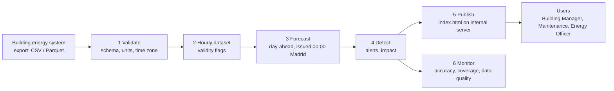

# Deployment and Handover Plan — Energy Waste & Anomaly Detection (CeDInt Storey 1)

**Backlog items:** PB-04 (deployment and handover context), PB-56 (deployment and handover plan), PB-05 (explicit exclusions)
**Audience:** Sponsor / Technical Owner and the UPM Responsible who will operate or extend the tool
**Version:** 12 Nov 2026 · Handover date: 14 Dec 2026 (Moodle delivery)

> **Reading note.** Statements about what the project delivered are facts of the repository. Effort figures, thresholds for monitoring and timings of future phases are **planning estimates by the project team**. They are marked *(estimate)* and must be confirmed by UPM before any commitment.

---

## 1. What is handed over

| Deliverable | Content | Where |
|---|---|---|
| Dashboard | Self-contained `index.html` (8 screens), opens offline | `Sprint4_UX_EnergyWatch/index.html` |
| Source and rebuild scripts | Python scripts that recompute every number, HTML template | `Sprint4_UX_EnergyWatch/source/` |
| Forecast model | Frozen Blend v1.3 and its components, code, configurations, tuning logs | `TBDA_v1.3_ChronosGBM_29-10/` |
| Model comparison | Task 6 results, forecasts of 11 models | `Task6_rev0_03-11/` |
| Data | Frozen source data, clean data, hourly dataset v1.2, data dictionary | repository root, `TBDA_v1.3.../derived/` |
| Documentation | Technical documentation, decisions, experiment log, detection validation, this plan, backlog coverage | `Sprint4_UX_EnergyWatch/docs/` |
| User guide, usability test | Prepared by the team | delivered with the final package |

## 2. What the product is and is not (PB-02, PB-05)
- It is a **historical-data decision-support tool**. It tells the user where consumption left its normal range and what that may have cost.
- It **does not control** lighting, HVAC or any equipment.
- **Excluded from this delivery:** real-time streaming, changes to the live building data pipeline, integration with specific hardware, automatic notifications, user accounts.

## 3. Deployment options

| Option | What it is | Infrastructure | Data freshness | When to choose it |
|---|---|---|---|---|
| **A. File hand-over (delivered)** | `index.html` is shared by email, Moodle or a shared drive and opened in a browser | none | frozen: 22 Sep – 5 Oct 2025 | Demonstration, review, training of users. **This is the delivered state.** |
| **B. Internal web page with scheduled refresh (recommended next step)** | A scheduled job rebuilds `index.html` from fresh exports and publishes it on an internal web server (static page, access-controlled) | one small server or container, Python 3.10+, scheduler | daily or weekly | A pilot with real data, with the UPM Responsible as owner |
| **C. Live service** | Automatic ingestion from the building system, a database, a forecasting service and an interactive web application | server, database, ingestion, monitoring, backup | hourly or near real time | Only if UPM decides to operate the tool continuously. Outside the delivered scope. |

**Recommendation:** keep A for the project close, run B as a time-boxed pilot (one heating season is needed to prove the model, see section 6), and decide on C only after the pilot.

## 4. Target architecture for the pilot (option B)

| Step | Existing code | Gap for the pilot |
|---|---|---|
| 1 Validate | data dictionary, quality rules D1–D5 (`DECISIONS_v1.2.md`) | an automatic schema and unit check |
| 2 Hourly dataset | `run_task7.py` and the v1.2 pipeline | run on new periods; keep the frozen-file checksum rule |
| 3 Forecast | frozen models (`models/*.joblib`), `Task6_rev0_03-11/generation/run_task6_v13_predictions.py`, `chronos_model.py` | a runner that takes a date and writes forecasts; Chronos-Bolt weights must be available on the server (downloaded once from Hugging Face) |
| 4 Detect | `build_data.py` | read a longer window; arguments for dates |
| 5 Publish | `build_html.py` | upload to the internal server |
| 6 Monitor | Reliability screen, `accuracy` scripts | a scheduled report and alert thresholds (section 6) |

## 5. Data requirements for live operation

| Requirement | Detail | Reason |
|---|---|---|
| Source | Export of the energy meters of Storey 1 (same structure as the frozen file): `Timestamp`, `energy_Wh` or counters `Ea/Er`, `W`, `I`, environmental and presence columns per device | The model and quality rules depend on these fields |
| Resolution | Minute level, as in 2025 | Hourly aggregation rules assume it |
| Time basis | UTC stored, Europe/Madrid for display | PB-16 |
| Latency | Complete data of day D available before 00:00 of day D+1 (day-ahead forecast is issued at 00:00 Madrid) | Forecast timing is fixed by the protocol |
| Completeness | Missing intervals stay missing, never zero | Specification §5 |
| Circuit mapping | Validated circuit → load-type mapping recorded in the data dictionary | PB-06, PB-12 |
| Units | Confirm units of `W` and `I` | Currently "assumed" in the data dictionary |
| Presence sensors | Working detectors in all zones (NE has none, SW is stuck) or a confirmed occupancy calendar | Occupied-hours rule |
| Tariff and CO₂ | Real electricity tariff and CO₂ treatment (guarantee of origin) | Replace the assumptions of `02_Assumptions_and_Decisions.md` |
| Calendar | UPM holidays and closures | `is_holiday` currently ES/MD only |

## 6. Retraining and monitoring

### 6.1 Why retraining matters
The model was fitted on about five late-summer weeks (19 Aug – 21 Sep 2025) and evaluated on two single weeks. It has not seen winter, the heating season, exams, holidays or building changes. Forecast quality outside the training season is **unknown** (technical documentation §10).

### 6.2 Retraining policy *(estimate, to confirm)*
| Trigger | Action |
|---|---|
| Start of each season (at minimum at the start of the heating season and again after one full year of data) | Re-run the v1.3 tuning pipeline on a training window that includes the new season; keep the same chronological protocol and rule D10 |
| A structural change (new equipment, refurbishment, schedule change) | Re-check the training window and retrain if the baseline moved |
| Monitoring thresholds below are crossed for two weeks in a row | Investigate data first, then retrain |

The procedure and run order are in `TBDA_v1.3_ChronosGBM_29-10/README_v1.3.md`. The repository estimates the compute as: GBM 5–10 min, ChronosGBM about 10 min, Blend under 1 min, Chronos grid 1–2 hours, all on CPU.

### 6.3 Monitoring indicators *(thresholds are initial estimates, to be calibrated during the pilot)*
| Indicator | Where it comes from | Initial threshold |
|---|---|---|
| Scaled MAE of the last 7 days against its validation value (0.27 / 0.35 / 0.35 at +1 h / +6 h / day-ahead) | forecast vs actual | alert if more than 25 % above |
| Normal-range coverage | share of hours inside q10–q90 | alert if below 70 % or above 90 % (target 80 %) |
| Share of valid hours | data quality flags | alert if below 80 % (88 % in the delivered window) |
| Alerts per day | detector | review thresholds if above 10 per day, or 0 for a week |
| Share of alerts marked "reviewed" with no finding | user feedback | use to tune the sensitivity |

## 7. Costs and effort *(estimate)*
No financial rates are known to the project. Costs are therefore given as **effort and resources**, to be priced by UPM.

| Item | Estimate | Basis |
|---|---|---|
| Pilot setup (steps 1–6 automated, server, access control) | 10–15 person-days | five Python modules to adapt plus deployment and tests |
| Operation during the pilot | 1–2 hours per week | check alerts and monitoring, handle data issues |
| Retraining | 1–2 person-days plus 2–3 CPU hours per season | repository run times plus review and documentation |
| Maintenance of rules and dashboard | 3–5 person-days per year | thresholds, calendar, circuit changes |
| Infrastructure for option B | one small server or container, no database, no GPU | batch job and static page |
| Infrastructure for option C | server, database, ingestion, monitoring, backup | to be specified if C is chosen |
| External data | Weather API only if temperature is added later (not used today) | Sprint 4 Task 2 |

## 8. Responsibilities

**Roles.** *UPM Responsible* means the person or team designated by UPM for energy and building operation. *Project Team* means TBDA Group 2 until the handover date. After handover, maintenance belongs to the party designated by UPM. R = does the work, A = accountable, C = consulted, I = informed.

| Activity | UPM Responsible | Project Team | Sponsor / Technical Owner |
|---|---|---|---|
| Accept the delivered package | A | R | C |
| Provide data exports and the data dictionary | R | C | A |
| Validate the circuit-to-load mapping | R | C | A |
| Provide tariff, CO₂ treatment, calendar, occupancy hours | R | I | A |
| Operate the dashboard and read alerts | R | I | I |
| Inspect alerts and decide actions | R | I | I |
| Monitor accuracy and data quality | R | C (during pilot) | A |
| Retrain and re-freeze the model | A | R (pilot), then UPM-designated party | C |
| Change alert thresholds | A | C | C |
| Host and secure the page | R | C | A |
| Decide on a live service (option C) | A | C | A |

## 9. Assumptions and dependencies
1. The building energy system can export minute-level data in the frozen-file structure.
2. Chronos-Bolt weights can be downloaded once from Hugging Face and stored on the server.
3. UPM designates an owner for the tool and a person for data questions.
4. The circuit-to-load mapping and the units of `W` and `I` are confirmed.
5. The tool remains advisory: nobody changes equipment settings automatically on its output.
6. The occupied-hours rule (weekdays 07:00–20:00) is confirmed or replaced.

## 10. Risks and mitigations
| Risk | Effect | Mitigation |
|---|---|---|
| Model not valid in winter | wrong expected values, false alerts | pilot over a heating season, retraining policy, monitoring thresholds |
| Data gaps or sensor faults | alerts missed or lost | data issues are shown separately and never counted as waste; sensor checks by UPM |
| Alert fatigue | users ignore the tool | three sensitivities, grouped alerts, weekly review of thresholds |
| Wrong cost figures | credibility | the price is an editable assumption and is labelled *estimated* until the tariff is provided |
| A permanent load flagged as waste (NW plugs, about 535 Wh/h) | wasted inspections | confirm with UPM; adapt the baseline rule |
| Loss of know-how | tool cannot be maintained | documentation, reproducible rebuild, experiment log |
| Access to private building data | confidentiality | static page behind UPM access control; no personal data (presence is aggregated by zone) |

## 11. Handover plan *(timings are estimates)*
| Phase | When | Content | Result |
|---|---|---|---|
| 0. Closure | by 14 Dec 2026 | Final package on Moodle, repository tidy, documentation complete | Option A delivered |
| 1. Knowledge transfer | within 2 weeks of acceptance | One session with the UPM Responsible: data, model, rules, rebuild | Rebuild reproduced by UPM |
| 2. Pilot decision | after Phase 1 | UPM decides on option B and names the owner | Go or stop |
| 3. Pilot | one heating season | Automated refresh, monitoring, threshold calibration | Measured accuracy and false-alarm behaviour on real events |
| 4. Review | end of pilot | Retrain, confirm tariff and mapping, decide on option C | Operational decision |

## 12. Acceptance checklist
- [ ] `index.html` opens on UPM computers without installation.
- [ ] `python source/run_all.py` rebuilds the package from the repository (verified by the team on 12 Nov 2026: identical `data.json`, about 13 seconds).
- [ ] The UPM Responsible has the data dictionary, the circuit mapping and the open points list (`02_Assumptions_and_Decisions.md`, §7).
- [ ] Tariff and CO₂ treatment provided, or the *estimated* labels accepted.
- [ ] Owner and data contact named by UPM.
- [ ] Limitations read and accepted (`01_Technical_Documentation.md`, §10).
